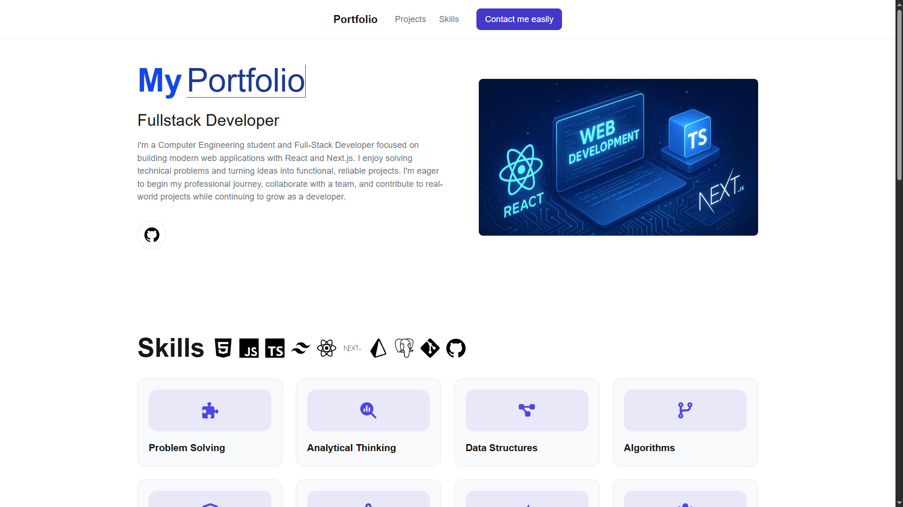

# My Portfolio

A personal portfolio website built with Next.js, TypeScript, and Tailwind CSS to showcase my skills, technologies, and projects.

## Live Demo

[View My Portfolio](https://my-portfolio-theta-ochre-40.vercel.app/)

## Features

- Responsive design for desktop and mobile devices
- Introduction and developer profile
- Technical skills and technologies
- Project showcase
- Contact form powered by Formspree
- Navigation to GitHub and project links

## Screenshot



## Tech Stack

- Next.js
- React
- TypeScript
- Tailwind CSS
- Formspree

## Getting Started

### Prerequisites

- Node.js
- npm

### Installation

1. Clone the repository.
2. Install dependencies:

   ```bash
   npm install
   ```

3. Configure any required environment variables for the contact form, if applicable.

4. Start the development server:

   ```bash
   npm run dev
   ```

5. Open [http://localhost:3000](http://localhost:3000).

## Featured Project

### KSP Shop

A full-stack e-commerce application featuring authentication, product management, a shopping cart, checkout, order tracking, and an admin dashboard.

## Author

GitHub: https://github.com/code-ofwar


